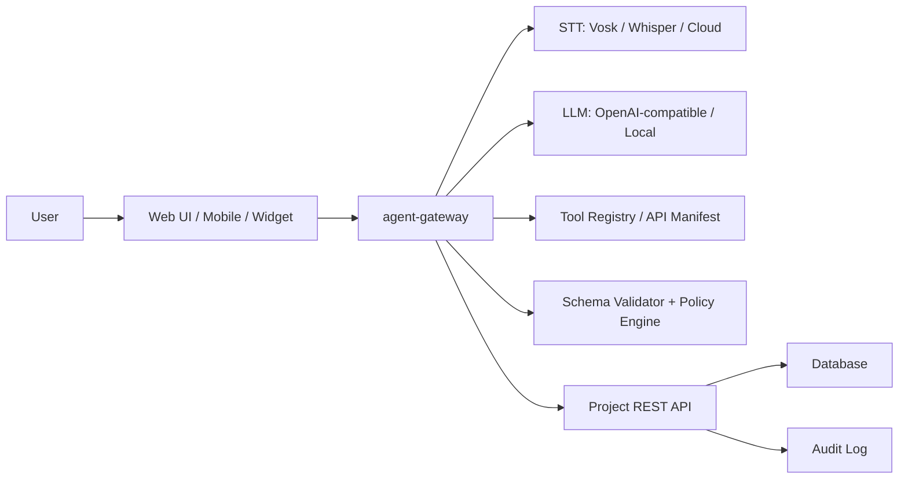

# Voice Text Agent Guide

Документация по реализации голосового и текстового AI-агента, который встраивается поверх существующего проекта и управляет его сущностями через разрешенные REST-команды.

## Идея

Агент работает как альтернативный интерфейс к приложению:

1. Пользователь пишет или говорит команду.
2. Агент распознает намерение и извлекает поля.
3. Если данных не хватает, агент задает уточняющий вопрос.
4. Для изменяющих действий агент показывает план и ждет подтверждение.
5. После подтверждения отдельный `agent-gateway` вызывает REST API основного проекта.
6. Backend сохраняет audit marker, что действие выполнено через `AI_AGENT`.

Ключевой принцип: LLM не получает свободный доступ к API. Все действия идут через allowlist/tool manifest, schema validation, policy checks и подтверждение пользователя.

## Документы

| Файл | Назначение |
| --- | --- |
| [docs/rentcrm/voice-text-agent-analytics.md](docs/rentcrm/voice-text-agent-analytics.md) | Основная аналитика и архитектура голосового/текстового агента для RentCRM/Rental Management. |
| [docs/rentcrm/rentcrm-sdd.md](docs/rentcrm/rentcrm-sdd.md) | Системный дизайн RentCRM: сущности, роли, API, безопасность и deployment. |
| [docs/rentcrm/project-knowledge.md](docs/rentcrm/project-knowledge.md) | База знаний RentCRM: конкуренты, позиционирование, уже добавленные функции и backlog. |
| [docs/general/ai-agent-guide-java-spring.md](docs/general/ai-agent-guide-java-spring.md) | Общий guide по AI-агентам на Java/Spring, tool calling, guardrails и production-практикам. |
| [docs/audio/audio-api-research.md](docs/audio/audio-api-research.md) | Исследование STT/audio API и вариантов транскрибации для голосового режима. |

## Рекомендуемый MVP

1. Подготовить `tool manifest` для 5-7 команд.
2. Реализовать отдельный `agent-gateway` с текстовым `POST /agent/message`.
3. Использовать LLM только для структурированного JSON: intent, fields, missing fields, reply.
4. Валидировать payload вне LLM.
5. Хранить pending action до подтверждения.
6. Выполнять REST-запрос только после подтверждения.
7. Добавить в основной backend agent session token, scopes и audit marker.
8. После текстового MVP добавить голосовой слой через STT.

## Базовая архитектура

## Что не делать в MVP

- Не давать LLM полный OpenAPI.
- Не разрешать delete/mass actions голосом.
- Не выполнять write actions без подтверждения.
- Не хранить голосовые записи бессрочно.
- Не смешивать агентную бизнес-логику с React-компонентами.
- Не давать LLM формировать произвольные HTTP-запросы.
